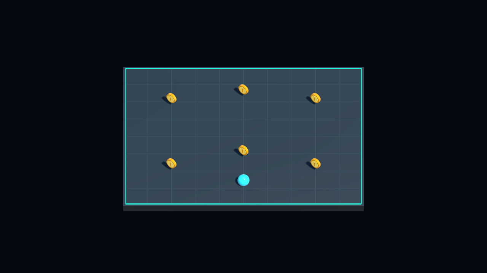

# Coin Collector 3D - UF2

Practica **Nucli del joc**, RA2 (2a-2c). Una bola controlada con fisica recoge seis monedas en un nivel 3D. Incluye las dos ampliaciones: giro y flotacion de monedas.

**Version utilizada y probada: Unity 6.6, 6000.6.2f1.** El enunciado original pide Unity 6 LTS. Esta entrega usa la version 6.6 instalada en el equipo; no se ha validado en LTS.

## Abrir y jugar

1. Clona este repositorio o descomprime la copia del proyecto.
2. En Unity Hub, usa **Add > Add project from disk** y elige la carpeta que contiene `Assets`, `Packages` y `ProjectSettings`.
3. Abre el proyecto con **Unity 6.6 (6000.6.2f1)**. La version exacta queda registrada en `ProjectSettings/ProjectVersion.txt`.
4. Abre `Assets/Scenes/MenuPrincipal.unity` y pulsa el boton Play del editor. El boton **Play** del menu carga `Level1`.
5. Mueve la bola y recoge las seis monedas. Abre **Window > General > Console** para ver la puntuacion.

| Tecla | Accion |
| --- | --- |
| WASD o flechas | Mover la bola |
| R | Reiniciar el nivel |
| F | Demostrar una caida real hacia la KillZone |
| Esc | Volver al menu |

`F` coloca la bola fuera del suelo, a una altura de 2 metros. La gravedad hace que caiga: no llama directamente a `RestartLevel`. Asi se puede demostrar el trigger de muerte sin modificar el nivel ni desactivar las paredes.

## Requisitos implementados

| Requisito del enunciado | Donde comprobarlo |
| --- | --- |
| Plane horizontal, tag Ground | `Level1 > LevelGeometry > Ground` |
| Cuatro cubos invisibles con Is Trigger | `Level1 > InvisibleWalls_Triggers` |
| KillZone invisible bajo el nivel | `Level1 > KillZone` |
| Sphere, Rigidbody, SphereCollider y tag Player | `Level1 > Player` |
| WASD/flechas mediante Horizontal y Vertical | `PlayerController.cs` e Input Manager |
| speed configurable en Inspector | `Player > PlayerController > Speed` |
| FixedUpdate, linearVelocity y conservacion de Y | `PlayerController.FixedUpdate` |
| Freeze Rotation X y Z | `Player > Rigidbody > Constraints` |
| Prefab Coin dorado y SphereCollider trigger | `Assets/Prefabs/Coin.prefab` |
| Seis instancias del prefab | `Level1 > Coins` |
| OnTriggerEnter, +1 punto y Destroy | `Coin.cs` |
| Log `Coin collected! Score: X` | Console al recoger cada moneda |
| Singleton Instance, int score y AddScore | `GameManager.cs`; propiedad de lectura `Score` |
| Reinicio por indice de escena activa | `GameManager.RestartLevel` |
| Log `Player killed!` y reinicio al caer | `KillZone.cs`; pulsa F para demostrarlo |
| MenuPrincipal con Canvas y boton Play | `MenuPrincipal.unity`, evento persistente del boton |
| Las dos escenas incluidas en la compilacion | File > Build Profiles > Scene List |
| Giro sobre Y | `Spinner.cs` en el prefab |
| Flotacion con Mathf.PingPong | `CoinFloat.cs` en el prefab |

Las paredes son triggers, tal como exige el enunciado. Un trigger detecta entradas pero no bloquea fisicamente. `BoundaryWall.cs` corrige la posicion y elimina la componente de velocidad que sale del recinto, conservando la velocidad vertical.

## Estructura

```text
Assets/
  Scenes/       Level1.unity, MenuPrincipal.unity
  Scripts/      PlayerController, Coin, KillZone, GameManager,
                Spinner, CoinFloat, BoundaryWall, MenuPrincipal,
                PracticeShortcuts
  Prefabs/      Coin.prefab
  Materials/    Materiales del nivel, jugador y monedas
  Editor/       Generacion, compilacion y lanzador de verificaciones
  Tests/        Comprobaciones de integracion en Play Mode
Packages/       Dependencias del proyecto
ProjectSettings/ Configuracion, tags, ejes y escenas de compilacion
Docs/           Guion de defensa y pruebas
```

Las escenas y el prefab son assets editables guardados en disco; el juego no necesita generar el escenario al arrancar. Los campos de configuracion son privados con `[SerializeField]`; los metodos y propiedades publicos se limitan a la comunicacion entre componentes.

## Capturas reales




## Verificar la practica

Consulta [el plan de pruebas](Docs/PRUEBAS.md) y [la defensa oral de 3-5 minutos](Docs/DEFENSA_ORAL.md).

La compilacion Windows ha terminado correctamente. La [verificacion ejecutada en Play Mode](Docs/VERIFICACION.md) tiene resultado **PASS**. El informe enumera cada comprobacion realizada con Unity 6000.6.2f1.

Para regenerar las escenas desde el editor usa **UF2 > Regenerar practica (sobrescribe escenas)**. Este comando reemplaza las escenas de la practica: guarda antes cualquier cambio propio.

Para compilar un ejecutable de Windows usa **UF2 > Compilar Windows**. Se guarda en `Builds/Windows/CoinCollector3D.exe`; se necesita el modulo Windows Build Support (Mono).

Las verificaciones de integracion se ejecutan desde **UF2 > Verificar practica y cerrar editor**, o con el metodo `PracticeVerificationRunner.Run` desde la linea de comandos del editor, sin `-quit`: el verificador termina el proceso y escribe `Docs/VERIFICACION.md`. Guarda antes tus cambios. No deben confundirse una compilacion de scripts y una prueba completa de Play Mode.

## Entrega

Entrega el enlace del repositorio en Classroom. Al ser privado, el docente necesita acceso al repositorio desde su propia cuenta de GitHub; invita al usuario que indique el centro. No se incluye `Library`, `Temp`, `Logs` ni las compilaciones, porque Unity las reconstruye. Si usas el ZIP, conserva los archivos `.meta`.

El guion facilita la preparacion; la defensa oral y la entrega en Classroom las debes realizar tu.
